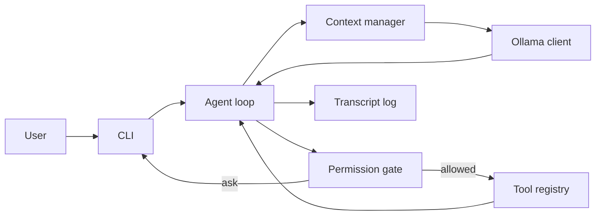

# agent-harness

A from-scratch agent harness in Python, running against local models via [Ollama](https://ollama.com). Built as a learning project: every layer (the agent loop, tool calling, permissions, context management) is implemented by hand rather than pulled from a framework.

## What is a harness?

A model only maps text to text. The **harness** is everything around it: it assembles the prompt, advertises tools, executes the tool calls the model requests, enforces what is allowed, and keeps the conversation inside the context window. The same model can behave very differently depending on the harness it runs in.

## Architecture



### Components

| Module | Responsibility |
|---|---|
| `cli.py` | REPL. Reads user input, renders streamed output, prompts for permission approvals. |
| `loop.py` | The agent loop. Calls the model, dispatches tool calls, repeats until done. |
| `llm/ollama.py` | Thin client for Ollama's `/api/chat`: streaming, tool schemas, `num_ctx`. |
| `tools/registry.py` | `@tool` decorator; builds JSON schemas from type hints and docstrings; dispatches calls. |
| `tools/builtin.py` | Built-in tools: `read_file`, `list_dir`, `write_file`, `run_shell`, `get_time`. |
| `permissions.py` | Policy engine: decides `allow` / `ask` / `deny` for each tool call. |
| `context.py` | Token budgeting, tool-output truncation, sliding window, compaction. |
| `transcript.py` | Append-only JSONL log of every request, response, and tool call. |
| `config.py` | Loads `harness.toml` (model, policy, budgets). |

### Project layout

```
agent_harness/
  cli.py
  loop.py
  config.py
  permissions.py
  context.py
  transcript.py
  llm/
    ollama.py
  tools/
    registry.py
    builtin.py
tests/
harness.toml
```

## The agent loop

The core of the harness. One user turn may involve many model calls.

```python
def run_turn(user_input):
    messages.append({"role": "user", "content": user_input})

    for step in range(MAX_STEPS):
        prompt = context.fit(messages, budget=NUM_CTX)       # trim / compact
        reply = llm.chat(prompt, tools=registry.schemas())   # stream
        messages.append(reply)
        transcript.log(prompt, reply)

        if not reply.tool_calls:
            return reply.content                              # final answer

        for call in reply.tool_calls:
            decision = permissions.check(call)                # allow / ask / deny
            if decision == ASK:
                decision = cli.prompt_user(call)
            if decision == DENY:
                result = error("Denied by user: <reason>")
            else:
                result = registry.execute(call)               # never raises
            messages.append({"role": "tool", "content": context.truncate(result)})

    return "Stopped: reached max steps."
```

Design rules:

- **Tool failures are data, not crashes.** Unknown tools, invalid arguments, timeouts, and exceptions are returned to the model as error results so it can recover. Small local models produce malformed calls often, so this matters.
- **Bounded execution.** `MAX_STEPS` caps runaway loops; every tool has a timeout and output cap.
- **Everything is logged.** The transcript is the primary debugging tool.

## Tools

Tools are plain Python functions:

```python
@tool(risk="read")
def read_file(path: str, start_line: int = 1, max_lines: int = 200) -> str:
    """Read a text file from the workspace."""
```

The registry derives the JSON schema the model sees from the signature and docstring, validates arguments before execution, and wraps every call so it returns a string result or a structured error.

| Tool | Risk | Notes |
|---|---|---|
| `get_time` | `read` | Trivial tool for testing the loop. |
| `list_dir` | `read` | Confined to the workspace root. |
| `read_file` | `read` | Paged reads with line ranges. |
| `write_file` | `write` | Confined to the workspace root. |
| `run_shell` | `exec` | Timeout, output cap, stripped environment, cwd = workspace. |

## Permissions and sandboxing

Every tool declares a **risk level**: `read`, `write`, or `exec`. A policy maps calls to a decision:

```toml
[permissions]
read  = "allow"
write = "ask"
exec  = "ask"

[[permissions.rules]]
tool = "run_shell"
match = "^git (status|diff|log)"
decision = "allow"

[[permissions.rules]]
tool = "run_shell"
match = "rm -rf"
decision = "deny"
```

Rules are checked most-specific first, then the risk-level default.

When the decision is `ask`, the CLI shows the call and offers: **allow once**, **always allow** (for the session), or **deny** with an optional reason that is passed back to the model.

Guardrails enforced regardless of policy:

- File paths are resolved and must stay inside the workspace root (no `..` or symlink escapes).
- Shell commands run with a timeout, a cap on output size, and a minimal environment (no API keys or other secrets inherited).
- Stretch goal: execute `run_shell` inside a Docker container.

## Context management

The context window is the scarcest resource, and Ollama's default `num_ctx` is small (often 2k–4k tokens). The harness sets `num_ctx` explicitly and budgets against it.

Strategies, applied in order before each model call:

1. **Truncate tool outputs.** Oversized results keep their head and tail with a marker like `[... 4,312 lines omitted ...]`.
2. **Sliding window.** Always keep the system prompt and the most recent turns; drop the oldest turns first. A tool call and its result are dropped together, never one without the other.
3. **Compaction.** When over budget, ask the model to summarize older turns and replace them with a single summary message.

Token counts start as an approximation (characters / 4) and can be swapped for a real tokenizer later.

## Configuration

`harness.toml`:

```toml
[model]
name = "qwen2.5:7b"
host = "http://localhost:11434"
num_ctx = 16384
temperature = 0.2

[loop]
max_steps = 20

[context]
tool_output_max_tokens = 2000
compact_at = 0.8   # fraction of num_ctx

[workspace]
root = "."
```

## Getting started

```bash
# 1. Install Ollama and pull a model with good tool-calling support
ollama pull qwen2.5:7b        # or llama3.1:8b

# 2. Set up the project
uv sync

# 3. Run
uv run python -m agent_harness.cli
```

## Roadmap

Each milestone ends with something runnable.

- [ ] **1. Setup.** Ollama installed, model pulled, project scaffolded with `uv`.
- [ ] **2. Plain chat loop.** `messages` list, streaming responses from Ollama.
- [ ] **3. Tool calling.** `@tool` registry, schema generation, the agent loop, error-as-result handling, `max_steps`.
- [ ] **4. Built-in tools.** `get_time`, `list_dir`, `read_file`, `write_file`, `run_shell`.
- [ ] **5. Permissions.** Risk levels, policy rules, interactive approval, workspace and shell guardrails.
- [ ] **6. Context management.** Token budgeting, truncation, sliding window, compaction.
- [ ] **7. Observability and polish.** JSONL transcripts, `--verbose` mode, `harness.toml` config.

### Concepts by milestone

| Milestone | Concept |
|---|---|
| 2–3 | The message protocol and the reason-then-act loop |
| 4 | Designing tools a model can use well |
| 5 | Trust boundaries and human-in-the-loop control |
| 6 | The context window as the primary resource |
| 7 | Debugging agents by reading their transcripts |

### Later

Out of scope for now, but the layout leaves room for: subagents, MCP tool servers, persistent memory, and evals.
