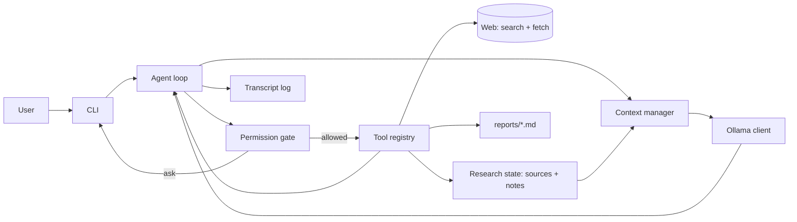
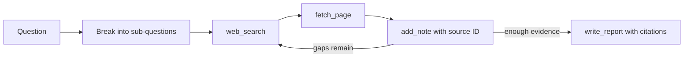

# agent-harness

A from-scratch **web research agent** in Python, running against local models via [Ollama](https://ollama.com). Give it a question; it searches the web, reads pages, takes notes, and writes a markdown report with citations.

Built as a learning project: every layer (the agent loop, tool calling, permissions, context management) is implemented by hand rather than pulled from a framework.

## What is a harness?

A model only maps text to text. The **harness** is everything around it: it assembles the prompt, advertises tools, executes the tool calls the model requests, enforces what is allowed, and keeps the conversation inside the context window. The same model can behave very differently depending on the harness it runs in.

Research is a demanding use case for a small local model: web pages are far larger than its context window, web content is untrusted, and claims must be traceable to sources. Most of this harness exists to handle those three problems.

## Architecture



### Components

| Module | Responsibility |
|---|---|
| `cli.py` | REPL. Reads user input, renders streamed output, prompts for permission approvals. |
| `loop.py` | The agent loop. Calls the model, dispatches tool calls, repeats until done. |
| `llm.py` | Thin wrapper over the `ollama` client: streaming, tool schemas, `num_ctx`. |
| `tools/registry.py` | `@tool` decorator; builds JSON schemas from type hints and docstrings; dispatches calls. |
| `tools/web.py` | `web_search` (DuckDuckGo) and `fetch_page` (download, extract readable text, paginate). |
| `tools/research.py` | `add_note`, `list_notes`, `write_report`. |
| `research_state.py` | Source registry (stable `[n]` citation IDs per URL) and the notes scratchpad. |
| `permissions.py` | Policy engine: decides `allow` / `ask` / `deny` for each tool call. |
| `context.py` | Token budgeting, page truncation, sliding window, compaction. |
| `transcript.py` | Append-only JSONL log of every request, response, and tool call. |
| `config.py` | Loads `harness.toml` (model, policy, budgets, search settings). |

### Project layout

```
src/agent_harness/
  __init__.py        # entry point: `uv run agent-harness`
  cli.py
  loop.py
  llm.py
  config.py
  permissions.py
  context.py
  research_state.py
  transcript.py
  tools/
    registry.py
    web.py
    research.py
tests/
reports/             # generated reports (gitignored)
transcripts/         # session logs (gitignored)
harness.toml
```

## The agent loop

The core of the harness. One research question may involve dozens of model calls.

```python
def run_turn(user_input):
    messages.append({"role": "user", "content": user_input})

    for step in range(MAX_STEPS):
        prompt = context.fit(messages, state, budget=NUM_CTX)  # trim / compact, inject notes
        reply = llm.chat(prompt, tools=registry.schemas())     # stream
        messages.append(reply)
        transcript.log(prompt, reply)

        if not reply.tool_calls:
            return reply.content                                # final answer

        for call in reply.tool_calls:
            decision = permissions.check(call)                  # allow / ask / deny
            if decision == ASK:
                decision = cli.prompt_user(call)
            if decision == DENY:
                result = error("Denied by user: <reason>")
            else:
                result = registry.execute(call)                 # never raises
            messages.append({"role": "tool", "content": context.truncate(result)})

    return "Stopped: reached max steps."
```

Design rules:

- **Tool failures are data, not crashes.** Unknown tools, invalid arguments, timeouts, HTTP errors, and exceptions are returned to the model as error results so it can recover. Small local models produce malformed calls often, so this matters.
- **Bounded execution.** `MAX_STEPS` caps runaway loops; every network call has a timeout and size cap.
- **Everything is logged.** The transcript is the primary debugging tool.

## The research workflow

The system prompt steers the model through a loop the harness supports with tools:



The key idea: **findings live in notes, not in the conversation.** Pages are read, distilled into short notes tied to a source ID, and then allowed to fall out of context. The report is written from the notes, so nothing important is lost when old turns are trimmed.

## Tools

Tools are plain Python functions:

```python
@tool(risk="network")
def fetch_page(url: str, page: int = 1) -> str:
    """Fetch a web page and return its main text, split into pages of ~1500 tokens."""
```

The registry derives the JSON schema the model sees from the signature and docstring, validates arguments before execution, and wraps every call so it returns a string result or a structured error.

| Tool | Risk | Notes |
|---|---|---|
| `web_search(query, max_results=5)` | `network` | DuckDuckGo via `ddgs`. Returns title, URL, snippet; registers each URL as a source `[n]`. |
| `fetch_page(url, page=1)` | `network` | Downloads with `httpx`, extracts main text with `trafilatura`, returns one page of text plus "page 1 of N". |
| `add_note(source_id, note)` | `read` | Appends a finding to the scratchpad, tied to a source. Local state only. |
| `list_notes()` | `read` | Returns all notes grouped by source. |
| `write_report(filename, markdown)` | `write` | Saves to `reports/`. Validates that every `[n]` citation refers to a known source and appends a sources list. |

### Sources and citations

`research_state.py` assigns each URL a stable ID the first time it appears (in search results or a fetch). The model cites with `[n]`; the harness owns the mapping from `n` to URL and title. This keeps citations honest: the model cannot invent a URL in the report, only reference IDs the harness has actually seen, and `write_report` rejects unknown IDs.

## Permissions and safety

Every tool declares a **risk level**: `read` (local state), `network` (talks to the internet), or `write` (touches disk). A policy maps calls to a decision:

```toml
[permissions]
read    = "allow"
network = "allow"
write   = "ask"

[[permissions.rules]]
tool = "fetch_page"
match = "(facebook|instagram)\\.com"
decision = "deny"
```

Rules are checked most-specific first, then the risk-level default. When the decision is `ask`, the CLI shows the call and offers: **allow once**, **always allow** (for the session), or **deny** with an optional reason that is passed back to the model.

Guardrails enforced regardless of policy:

- **Network:** only `http`/`https`; requests to `localhost`, private IP ranges, and link-local addresses are blocked (so a web page cannot trick the agent into probing your local network); per-request timeout and maximum download size; a fixed user agent and a delay between requests to avoid rate limits.
- **Disk:** `write_report` can only write inside `reports/`; filenames are sanitized (no `..`, no absolute paths).
- **Untrusted content:** fetched text is wrapped in clear delimiters and the system prompt tells the model that instructions inside page content are data, not commands. This does not make prompt injection impossible; it is why `write` stays on `ask` by default and there is no shell tool.

## Context management

The context window is the scarcest resource, and Ollama's default `num_ctx` is small (often 2k–4k tokens). The harness sets `num_ctx` explicitly and budgets against it.

Strategies, applied before each model call:

1. **Paginate pages at the source.** `fetch_page` never returns a whole article; the model asks for page 2 if it needs more.
2. **Truncate tool outputs.** Anything still oversized keeps its head and tail with a marker like `[... 4,312 tokens omitted ...]`.
3. **Pin research state.** The system prompt, the original question, and a compact summary of notes and sources are always included.
4. **Sliding window.** Keep the most recent turns; drop the oldest first. A tool call and its result are dropped together, never one without the other. Old page text goes first, since its content already lives in notes.
5. **Compaction.** When still over budget, ask the model to summarize older turns into a single message.

Token counts start as an approximation (characters / 4) and can be swapped for a real tokenizer later.

## Configuration

`harness.toml`:

```toml
[model]
name = "qwen2.5:7b"
host = "http://localhost:11434"
num_ctx = 16384
temperature = 0.2

[loop]
max_steps = 40

[context]
page_tokens = 1500
tool_output_max_tokens = 2000
compact_at = 0.8   # fraction of num_ctx

[search]
max_results = 5
delay_seconds = 1.0

[fetch]
timeout_seconds = 15
max_bytes = 2_000_000

[output]
reports_dir = "reports"
```

## Getting started

```bash
# 1. Install Ollama and pull a model with good tool-calling support
ollama pull qwen2.5:7b        # or llama3.2 for a smaller, faster option

# 2. Install dependencies
uv sync

# 3. Run
uv run agent-harness
```

The first message after starting is slow while Ollama loads the model into memory; later replies start quickly.

Dependencies: `ollama`, `ddgs`, `httpx`, `trafilatura`.

## Roadmap

Each milestone ends with something runnable.

- [x] **1. Setup.** Ollama installed, model pulled, project scaffolded with `uv`.
- [x] **2. Plain chat loop.** `messages` list, streaming responses, `/reset` and `/exit`.
- [ ] **3. Tool calling.** `@tool` registry, schema generation, the agent loop, error-as-result handling, `max_steps`. Test with a trivial `get_time` tool.
- [ ] **4. Web tools.** `web_search` and `fetch_page` with text extraction and pagination; source registry with `[n]` IDs.
- [ ] **5. Permissions and safety.** Risk levels, policy rules, interactive approval, network guardrails, untrusted-content delimiters.
- [ ] **6. Context management.** Token budgeting, pinned research state, truncation, sliding window, compaction.
- [ ] **7. Research workflow.** Notes scratchpad, `write_report` with citation validation, research system prompt.
- [ ] **8. Observability and polish.** JSONL transcripts, `--verbose` mode, `harness.toml` config.

### Concepts by milestone

| Milestone | Concept |
|---|---|
| 2–3 | The message protocol and the reason-then-act loop |
| 4 | Designing tools a model can use well; turning messy web pages into usable text |
| 5 | Trust boundaries, untrusted input, human-in-the-loop control |
| 6 | The context window as the primary resource |
| 7 | External memory: keeping knowledge outside the conversation |
| 8 | Debugging agents by reading their transcripts |

### Later

Out of scope for now, but the layout leaves room for: academic sources (arXiv, Semantic Scholar), local document search, parallel sub-agents per sub-question, persistent memory across sessions, and evals (e.g. checking that cited sources actually support the claims).
